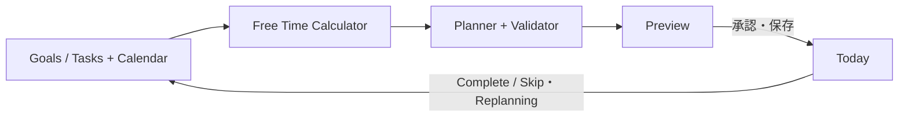
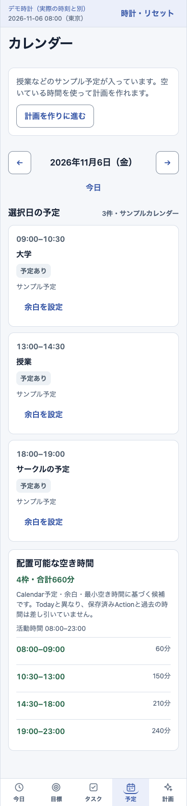

# AI Life Planner

カレンダーの予定とGoals / Tasksから空き時間を計算し、その日の行動計画を自動生成するライフプランニングアプリ。
React Native / ExpoによるNative版と、ログイン不要のWeb Demoで同じPlannerロジックを使います。

## Demo

**Web Demoは公開準備済みです。GitHub Pagesの初回公開・動作確認後、この節へ公開URLを追加します。**

APIキーやアカウントなしで、サンプルの一日をブラウザで試せます。

```sh
npm ci
npm run export:pages
npm run verify:pages
npm run preview:pages
```

[ローカルのWeb Demoを開く](http://127.0.0.1:4173/ai-life-planner/) → Tasksを確認 → Calendarの空き時間を確認 → Plannerで生成 → Previewを保存 → Todayで完了・スキップ。

サンプル時計は**2026年11月6日08:00（東京）**に固定しています。「時計を15:00に進める」で再計画を試せます。
データはこのタブのメモリ内に保持し、reload・リセットで初期化します。Supabase・端末Calendar・OpenAIへの接続は不要です。
公開手順は[Web Demoガイド](docs/web-demo.md)を参照してください。

## Overview

目標を立てても、今日いつ何をするかまで決めるのは難しい。タスクリストとカレンダーが別々だと、
予定の合間に使える時間も見落としがちです。

AI Life Plannerは、目標を具体的なTaskへ分け、カレンダーの空き時間へ自動配置します。
提案を確認してから保存し、実行結果を記録して、残り時間の計画を組み直すところまでを一つの流れにしました。
自身が使うNativeアプリとして開発し、設計と動作を第三者にも試してもらえるようWeb Demoを用意しています。

## Main Features

| 機能                           | Native                                                               | Web Demo                             |
| ------------------------------ | -------------------------------------------------------------------- | ------------------------------------ |
| Goals / Tasks / Settings       | 目標・TaskのCRUD、所要時間・優先度・期限・計画設定                   | 同じ操作をサンプルデータで体験       |
| Calendar / Free Time           | 権限取得後に端末予定を読み取り、timezoneと活動時間から空き時間を計算 | サンプル予定から同じCalculatorで計算 |
| RuleBased Planner              | 期限・優先度・所要時間から決定的に配置。API不要                      | 同じProviderを使用                   |
| Optional OpenAI Planner        | 共通Contractに沿う任意Providerを実装                                 | 使用しない                           |
| Preview / Save / Today         | Validatorで検証し、承認後にDBへ保存して表示                          | メモリへ保存してTodayへ反映          |
| Complete / Skip / Activity Log | 完了時は関連Taskも完了。SkipはTaskを残し、実行履歴を保持             | 同じ操作・履歴を体験                 |
| Replanning                     | 最新データと残り時間で全置換。競合・古いPreviewを検知し、履歴は保持  | メモリ内の競合ガードで同じ流れを体験 |
| Auth / persistence             | Supabase Auth・RLS・PostgreSQLによるユーザー別保存                   | ログイン不要。reloadで初期化         |

Core v1 Native版の主要フローはiOS Simulator・iPhone 16で確認済みです。
無料Personal Team署名の**Release buildで、Metro停止・USB解除後のiPhone単体利用も確認済み**です。
再署名・上書きinstall手順と検証範囲は[Personal Team Release](docs/ios-personal-release.md)を参照してください。
OpenAIは任意機能の実装であり、実APIの動作確認を今回の検証範囲には含めていません。

## How it works



Nativeは端末CalendarとSupabase、Web DemoはサンプルCalendarとメモリ内Repositoryを入力・保存先に使います。
提案を作っただけでは保存せず、ユーザーの承認を境界にします。

## Screenshots

以下は**Web Demoの実画面**です。TOEIC学習のサンプルデータのみを使い、Native実機画面と区別しています。

<table>
  <tr><th>Today</th><th>Planner Preview</th><th>Calendar / Free Time</th></tr>
  <tr>
    <td></td>
    <td></td>
    <td></td>
  </tr>
</table>

[Desktop版・Goals / Tasksの画像と撮影手順](docs/screenshots/README.md)も用意しています。

## Tech Stack

| 領域               | 技術                                                                          |
| ------------------ | ----------------------------------------------------------------------------- |
| App / Web          | React Native 0.86.3、Expo SDK 57、React 19.2.3、React Native Web、Expo Router |
| 言語 / 品質        | TypeScript strict、Jest、React Native Testing Library、ESLint、Prettier       |
| Nativeデータ       | Supabase Auth、PostgreSQL、RLS、transactional RPC                             |
| Calendar / session | expo-calendar、expo-sqlite                                                    |
| 任意AI             | Supabase Edge Functions → OpenAI Responses API                                |
| CI / hosting       | GitHub Actions、GitHub Pages向けstatic export                                 |

## Architecture

- **Coreを共有**: 空き時間計算・候補選定・配置・ValidatorはNative / Webで共通のTypeScriptロジック。
- **Repository境界**: UIと業務処理はinterfaceへ依存し、Supabase / 端末Calendar / DemoのI/Oをadapterで分離。
- **Provider共通Contract**: RuleBasedと任意OpenAIの出力を`unknown`から共通Validatorで検証。
- **承認とatomic persistence**: Preview承認時に最新データで再検証し、NativeではPlanとActionをRPCで一括保存。
- **履歴と競合**: Activity Logは実行時点のsnapshot。Guarded Replanningで旧Previewの上書きを防ぎ、置換後も履歴を保持。
- **Demoの独立**: Web用compositionはNative側のAuth / Supabase / Calendar SDKをbundleへ取り込まず、production DBへ接続しない。

コードの入口と設計の説明は[Architecture](docs/architecture.md)、要件・検証の一覧は[docs index](docs/README.md)へ。

## Testing / Verification

- **54 test suites / 497 tests**（unit / integration）。Planner、timezone、Calendar正規化、CRUD、承認、保存、実行、履歴、再計画を検証。
- **iOS Simulator E2E・iPhone 16実機**でCore v1の主要フローを確認。[Native検証記録](docs/README.md#verification)
- **Web production export**をローカル配信し、生成→保存→実行→再計画、直接URL、reloadを確認。
- Desktop / Tablet / Mobile相当の1440 / 768 / 390 / 375px幅を確認。[Web検証記録](docs/web-demo.md#verification)

検証済み範囲と未確認事項は各記録に分けて記載しています。Android、全ブラウザ、全異常系の保証ではありません。

## Development / Local Setup

前提: Node.js `^22.13.0 || >=24`、npm。Web Demoは先頭の手順だけで動作します。

Native開発はiOS / Android開発環境と、自分のSupabase開発プロジェクトを用意します。

```sh
npm ci
cp .env.example .env
# .envに自分のSupabase Project URLとPublishable Keyを設定
npm run ios
# インストール済みdevelopment buildへ接続する場合
npm run start:dev
```

Calendar APIはExpo Goでは使えないためdevelopment buildが必要です。iOSのローカルbuildにはmacOS / Xcodeが必要です。
DB migrations・RLS確認・任意OpenAIの設定・Androidの手順は[開発ガイド](docs/development.md)へ。

```sh
npm run typecheck
npm run lint
npm run format:check
npm run test:ci
```

PR用CIでは上記の品質チェックを実行します。Pages公開workflowはmainを対象とした**手動実行のみ**です。

## Security

OpenAI API keyはSupabase Edge Function Secretにのみ置き、clientへ渡しません。
Supabaseの`service_role` / Secret Keyもclientへ置きません。`.env`はGit管理対象外で、`.env.example`は変数名のみです。
Web Demoはproduction SupabaseとOpenAIを使用せず、利用者の入力を公開サーバーへ保存しません。
公開前検査の範囲と残る確認は[公開準備・監査記録](docs/portfolio-release.md)にまとめています。

## License

[MIT](LICENSE)。Expo由来のcopyright noticeを保持しています。
