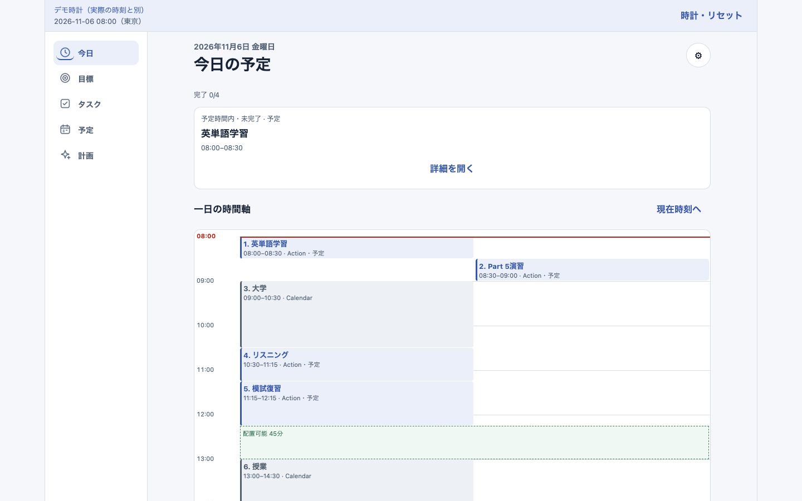
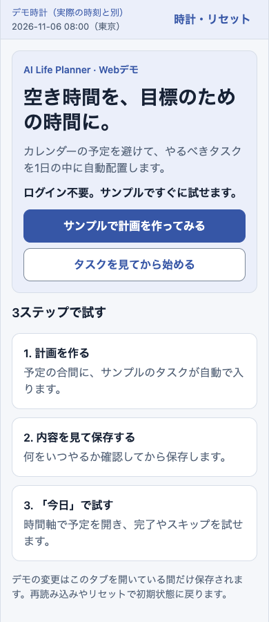
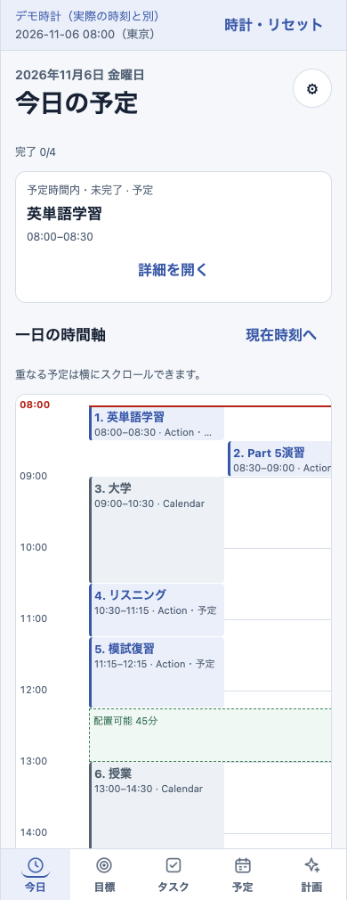

# AI Life Planner

カレンダーの予定を避けて、目標のためのタスクを1日の空き時間に自動で割り振るアプリです。

## Web Demo

**ログイン不要で、サンプルの計画づくりから実行までブラウザで試せます。**
GitHub Pagesは公開準備中です。公開後に確認したURLをここに掲載します。[ローカルで試す手順](#ローカルで試す)



保存した計画を「今日」で開いた画面です。次に取り組むタスクと、その日の予定が時間軸に並びます。

<details>
<summary>モバイル幅の入口・保存前の確認・今日の時間軸を見る</summary>

**Web Demoの入口** — サンプルですぐに計画を作るか、先にタスクを見るかを選べます。



**保存前の確認** — カレンダー予定と重ならない時間に入ったタスクを、時刻順に確認できます。


**保存後の「今日」** — 時間軸のカードを開いて、タスクを完了またはスキップできます。



</details>

カレンダーと空き時間、目標、タスク一覧、PC版の入口も掲載しています。[スクリーンショット一覧](docs/screenshots/README.md)

## 使い方

1. 入口の **「サンプルで計画を作ってみる」** から「今日の計画を作成」を押します。
2. 何をいつやるかを確認し、**「この計画を保存」** を押します。
3. **「今日の計画を見る」** から時間軸へ進み、タスクを開いて完了・スキップを試せます。
4. 予定を組み直したい場合は、デモ時計を15:00に進めてから「再計画する」を試せます。

Web Demoはルールベースで動作します。OpenAI APIは使いません。デモ時計はサンプル日の時刻で、データはこのタブのメモリに保持されます。再読み込みやリセットで初期状態に戻ります。

自分の使い方に合わせて、目標の進捗やタスクの所要時間・期限・優先度、活動時間や予定前後の余白も調整できます。iPhone向けNative版は、許可を得た端末カレンダーを読み取り、Supabaseでユーザー別に保存します。Native版には任意のOpenAI連携もあります。

## 制作背景

目標を立てても、いつ取り組むかを決めないままだと行動に移しにくくなります。タスクとカレンダーが別々だと、授業などの合間に何ができるかも見落としがちです。そこで、目標をタスクに分け、予定の合間の具体的な時刻に割り振り、実行結果に応じて組み直せるアプリを作りました。

## 技術的な工夫

- **空き時間を計算する。** 読み取った予定の重なりをまとめ、前後の余白と最小空き時間を考慮します。プロフィールのタイムゾーンを基準に、翌日深夜までの活動時間や夏時間（DST）の境界も扱います。
- **作成と保存を分ける。** ルールベースで期限・優先度・所要時間を使って配置し、承認時に最新の設定・予定・タスクで再検証します。保存条件を満たさなくなった提案は拒否します。
- **保存と実行の整合性を保つ。** NativeではSupabase Authと行レベルセキュリティ（RLS）を使い、計画と明細をDB関数内の一つのトランザクションで保存します。完了・スキップの履歴は再計画後も参照できます。
- **NativeとWebで計算を共用する。** 共通の計画・検証処理を使い、データの読み書きだけを切り替えます。Web Demoは端末カレンダーやSupabaseへ接続せず、サンプルとメモリ上のデータで動きます。

実装の入口と保存境界は[アーキテクチャ](docs/architecture.md)へ。制作の進め方とCodexの利用範囲は[ポートフォリオ用の開発紹介](docs/portfolio.md)にまとめています。

## 技術スタックと構成

| 領域        | 技術                                                                                 |
| ----------- | ------------------------------------------------------------------------------------ |
| アプリ・Web | React Native、Expo SDK 57、Expo Router、React Native Web                             |
| 計画・表示  | TypeScript、共通PlannerとValidator、Clearデザインシステム                            |
| Native連携  | Expo Calendar、Supabase Auth／PostgreSQL／RLS、任意のOpenAI用Edge Function           |
| 品質・配信  | Jest、React Native Testing Library、ESLint、Prettier、GitHub Actions、静的Web export |

`src/features` に機能ごとの画面と共通の業務処理、`src/services` にデータ接続を置き、`src/navigation` でプラットフォームごとに接続先を選びます。[設計・検証ドキュメント一覧](docs/README.md)

## テストと検証範囲

- **自動テスト** — 68スイート・715件が成功（2026年11月10日）。計画、時刻・DST、保存・実行・再計画などを検証しています。GitHub ActionsのCIで型・lint・フォーマットとJestを確認します。
- **Web／Simulator** — 最新のWeb exportをChromeで操作し、375pxと1440pxの初回体験、生成・保存・完了・スキップ・再計画を確認しました。iOS Simulatorでの時間軸、短い予定、文字拡大の確認は別記録にまとめています。[Web検証](docs/web-demo.md#今回の公開準備で確認した範囲) · [時間軸の検証](docs/today-time-axis.md)
- **iPhone実機** — Core v1の主要フローと、当時のRelease版のUSB・Metroなしでの起動を確認済みです。Step 10のPR #15相当版では一部を実機で再確認しました。実機VoiceOver・文字拡大、同版のUSB解除後の確認などが残っています。[Core v1の実機記録](docs/ios-personal-release.md) · [Step 10の確認範囲](docs/portfolio.md#実機とブラウザでの確認範囲)

OpenAI実API・Android・全ブラウザの動作は検証範囲外です。対応状況の詳細は[開発・検証記録](docs/README.md)を参照してください。

## ローカルで試す

Node.js `^22.13.0 || >=24` とnpmを用意します。Web Demoの起動に環境変数やアカウントは不要です。

```sh
npm ci
npm run export:pages
npm run verify:pages
npm run preview:pages
```

[ローカルのWeb Demoを開く](http://127.0.0.1:4173/ai-life-planner/)。Native開発には自分のSupabase開発プロジェクトと開発ビルドが必要です。iOSのビルドはmacOSとXcodeを使用します。[開発手順・品質チェック](docs/development.md)

## セキュリティ・ライセンス

端末カレンダーは読み取り専用です。NativeのOpenAI APIキーはSupabase Edge Function側で管理し、アプリには含めません。実際の `.env` やサーバー用の秘密鍵はGit管理の対象外です。[公開前チェック](docs/portfolio-release.md#現在のpages公開前チェック)

[MITライセンス](LICENSE)。Expo由来の著作権表示を保持しています。
